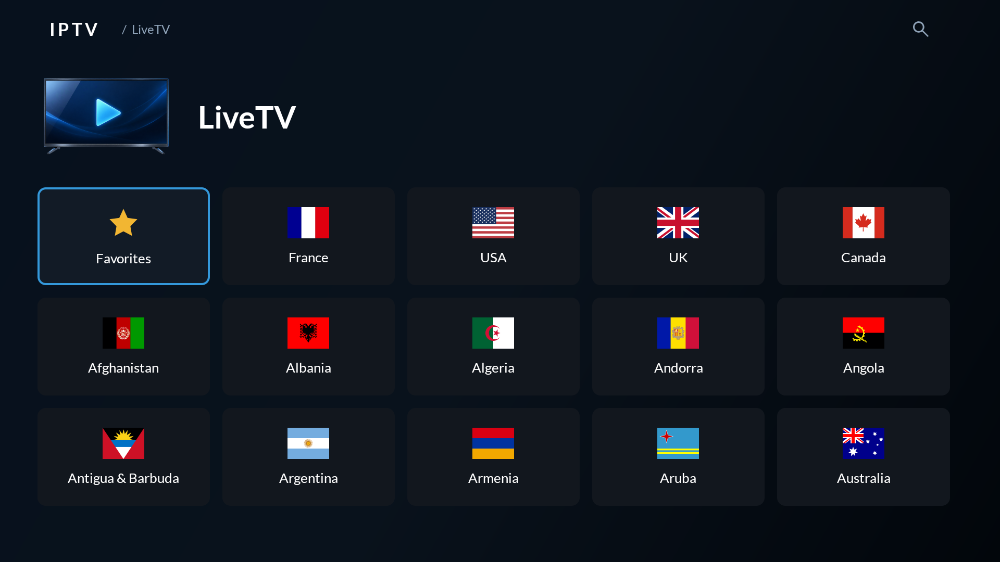
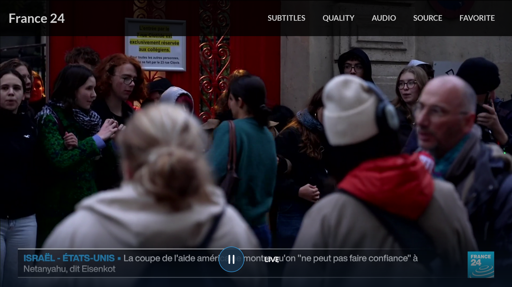
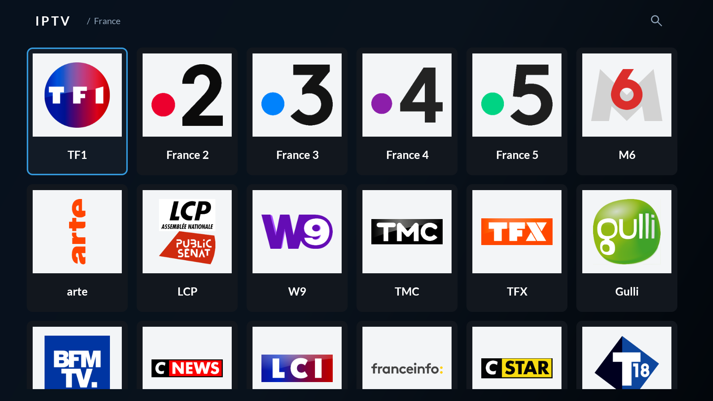

# IPTV

[](LICENSE)

Native Android TV app for live channels from the built-in
[iptv-org worldwide playlist](https://iptv-org.github.io/iptv/index.m3u).

- Home tiles: **Favorites → France → USA → UK → Canada**, then other countries.
- Worldwide country browsing, with France and USA first.
- Portrait channel cards with logos above names and a clean fallback for missing artwork.
- Country-specific channel lineups: France follows national DTT numbering; remaining channels follow alphabetically.
- Channel search from the TV, voice input where available, or a phone via QR code.
- Native fullscreen playback, quality/audio/subtitle selection, and explicit source selection.
- Saved favorites and manual ordering.
- Immediate local channel browsing, a persistent catalog, and explicit Refresh.

The interface follows the TV family's Lato typography, dark surfaces, blue focus,
Sports country grid, and Movies playback menus and phone search.

## Screenshots

| Countries | Live playback |
| --- | --- |
|  |  |



## Usage

Select a channel to watch. Hold **Select** on a channel to manage favorites
and their order. Use the home tiles for countries and collections;
Search covers the worldwide library. **Back** returns to the selected tile.

France uses the [metropolitan national DTT lineup](https://en.wikipedia.org/wiki/List_of_television_stations_in_France).
Other countries use alphabetical order unless a country lineup is configured.
USA uses one continuous lineup: **mainstream → news → movies → TV shows → music →
factual → sports → kids**. Familiar networks lead each group, followed by other
channels alphabetically. Unclassified channels remain available at the end.
Spanish-language channels are skipped in the US grid except sports; they remain
available through global search and existing Favorites. This ordering does not
add channels or change streams.
UK follows the [England Freeview/DTT lineup](https://en.wikipedia.org/wiki/List_of_DTT_channels_in_the_United_Kingdom),
with regional alternatives and other unlisted UK channels available afterward.
Favorites always keep your manual order.

Choose **Search** to type on the TV, use the microphone, or scan the QR code with
a phone on the same network. Enter a channel name to see matches, with country
flags for context. The search screen stays empty until you enter a query.

HD sources appear before SD when the playlist supplies quality labels. You can
still choose any available stream from **Source**.

During playback, use the top menus for subtitles, quality, audio, source, and
favorites. The bottom control pauses/resumes. **Back** hides controls, then returns
to the same channel in browsing. Streams are selected explicitly; reconnecting
retries the current stream.

Focus the **IPTV / section** header and press **OK** to open the menu.
**Refresh** reloads the built-in playlist and channel metadata.

## Build

Requires JDK 17 and Android SDK 36; checks and lineup tools also use Python 3.9+.
Runs on Android TV 8.0 or later.

```sh
git clone git@github.com:nbonamy/iptv-streams-tv.git
cd iptv-streams-tv
make check
make build
```

APK: `app/build/outputs/apk/debug/app-debug.apk`.

Installation always needs an explicitly selected target:

```sh
make install ANDROID_DEVICE=emulator-5554
make run ANDROID_DEVICE=emulator-5554
```

See [development](docs/development.md), [product direction](PRODUCT.md),
[visual conventions](DESIGN.md), and [third-party notices](THIRD_PARTY_NOTICES.md).

## License

Copyright 2026 Nicolas Bonamy. Original project source is licensed under the
[Apache License 2.0](LICENSE).

Third-party code, fonts, artwork and channel data retain their respective licenses;
see [NOTICE](NOTICE) and [third-party notices](THIRD_PARTY_NOTICES.md).
The Nextlib FFmpeg decoder dependency is GPL-3.0, so distribution of an APK
containing it must also comply with its GPL terms.
